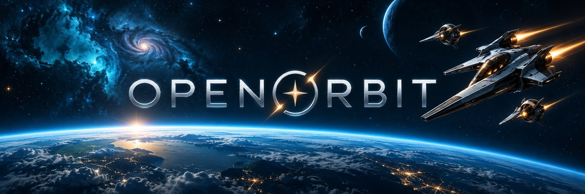
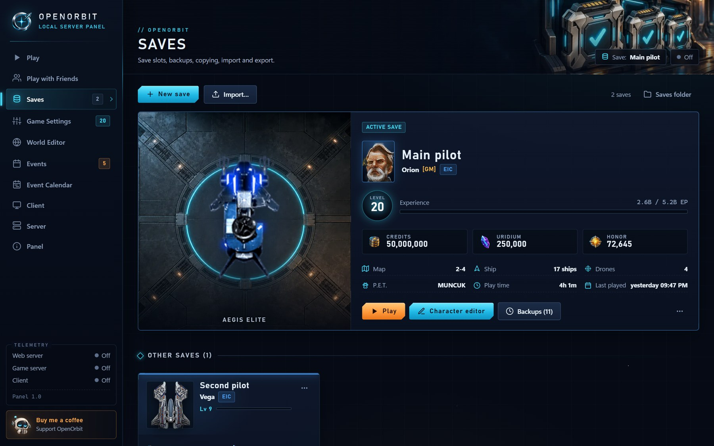
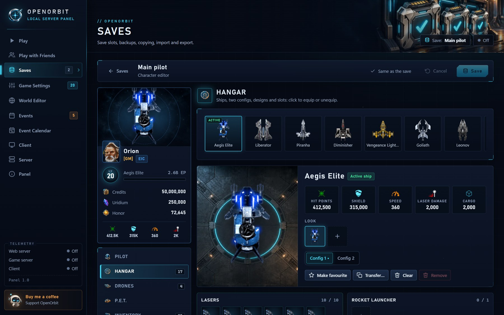
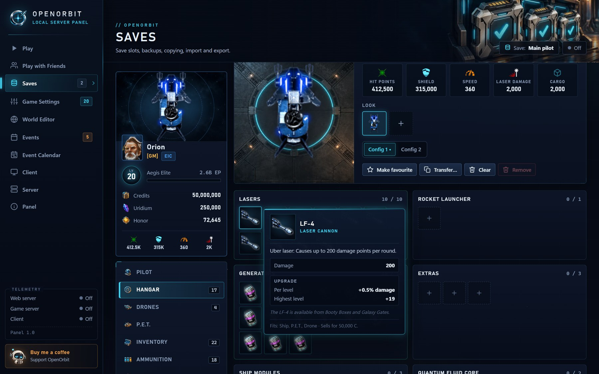
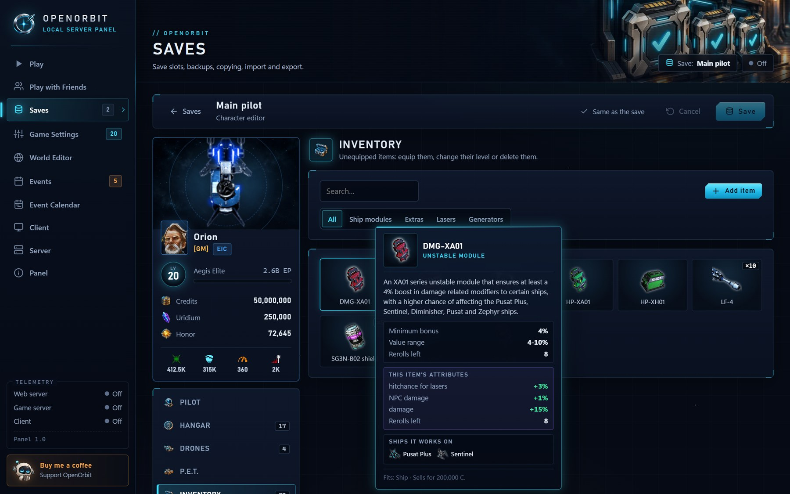
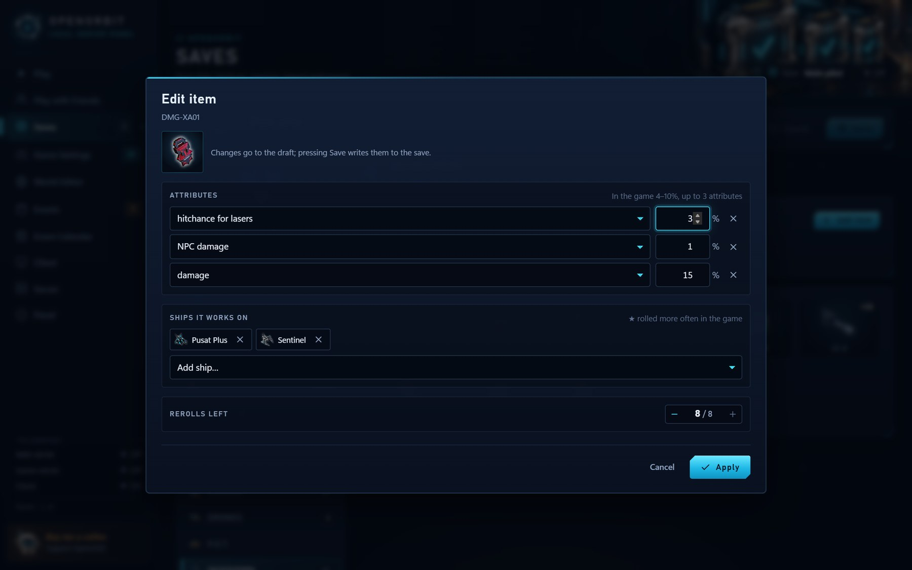
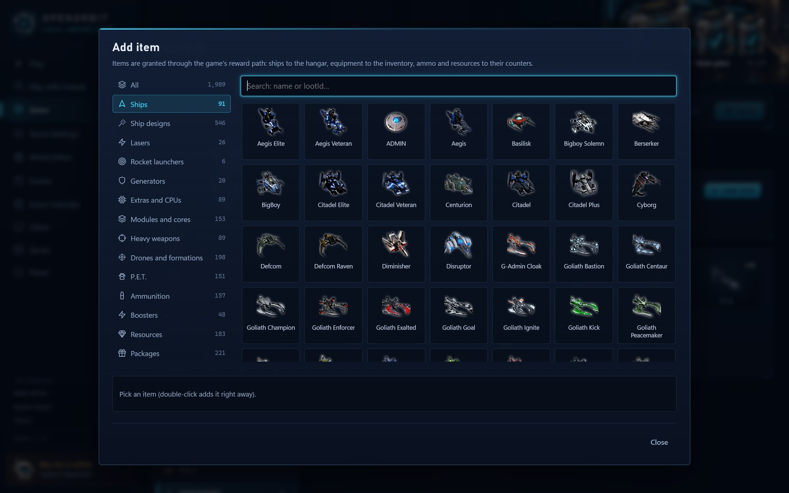
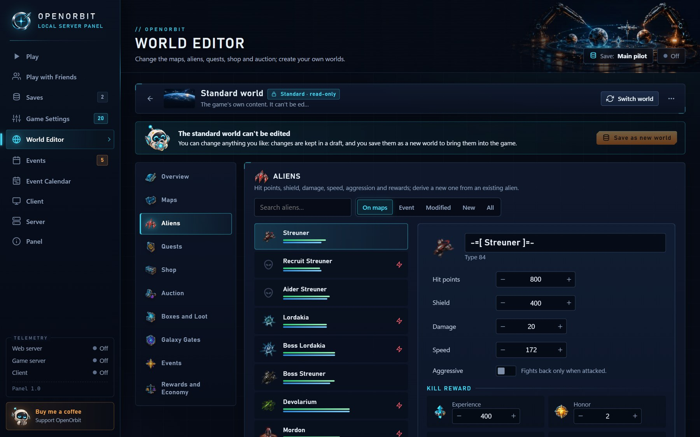
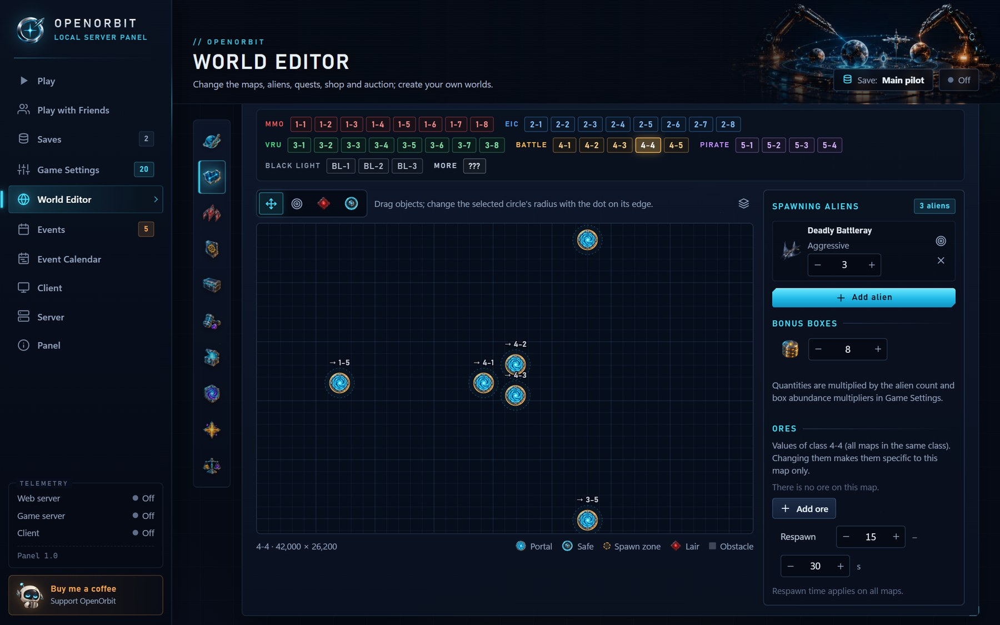
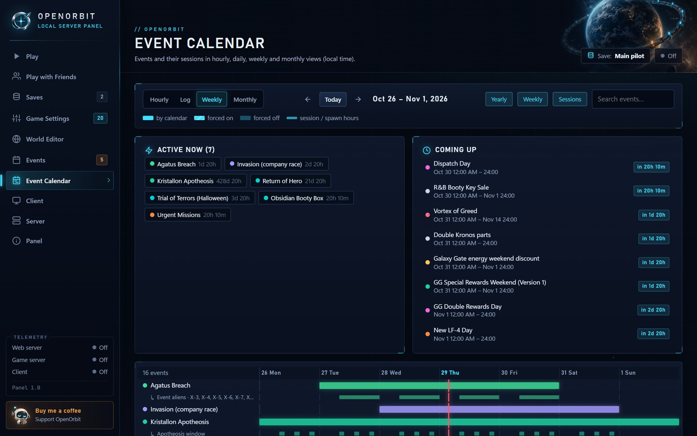

<p align="center">
  
</p>

<p align="center">
  <b>A single-player, offline server for the original DarkOrbit Unity client, with a desktop panel to run it all.</b>
</p>

<p align="center">
  <a href="https://discord.com/invite/openorbit"></a>
  
  
  
  
  <a href="LICENSE"></a>
</p>

<p align="center">
  <a href="#quick-start">Quick start</a> ·
  <a href="#screenshots">Screenshots</a> ·
  <a href="#features">Features</a> ·
  <a href="#playing-with-friends">Play with friends</a> ·
  <a href="#linux-and-macos">Linux and macOS</a> ·
  <a href="#faq-and-tips">FAQ</a> ·
  <a href="https://discord.com/invite/openorbit">Discord</a>
</p>

<p align="center">
  
</p>

## What is OpenOrbit?

OpenOrbit runs a game server on your own computer and starts the **original DarkOrbit client** against it. You play
alone, offline, at your own pace: the client never talks to the official servers, your progress is saved locally, and
everything about the game can be tuned from a desktop panel.

<table>
  <tr>
    <td width="33%" valign="top">
      <h3>🛰️ The whole game, offline</h3>
      Aliens on every map, Galaxy Gates, events on the real calendar, Season Pass, Skylab, Assembly and much more, on the
      unmodified client.
    </td>
    <td width="33%" valign="top">
      <h3>🎛️ A panel for everything</h3>
      One-click PLAY, save slots with backups, a full character editor, a world editor, game rules and multipliers. In 8
      languages.
    </td>
    <td width="33%" valign="top">
      <h3>🤝 Play with friends</h3>
      Host a server or join a friend's. Everyone keeps their own save, and you share the maps, the aliens and the chat.
    </td>
  </tr>
</table>

## Quick start

1. **Download** this repository (*Code › Download ZIP*) and extract it, or clone it.
2. **Double-click `OpenOrbit Panel.pyw`.** The panel opens in its own window.
3. **Follow the setup wizard:** choose a language, pick the game folder (the wizard **downloads the game for you** if it
   isn't on your computer), create your first pilot and choose a preset.
4. **Press PLAY.** The servers start and the game opens; press START on the client's login screen.

| You need | |
| --- | --- |
| **Windows 10 or 11** | Linux and macOS work too, through Proton or Wine: see [Linux and macOS](#linux-and-macos) |
| **[Python](https://www.python.org/downloads/) 3.10 or newer** | Nothing else to install |
| **The DarkOrbit Unity client 1.1.116** | Not included. The wizard downloads it from the official download server (about 3.5 GB; 4.4 GB of free space). If you have it already, the folder must contain `DarkOrbit.exe` and `DarkOrbit_Data` |
| **Edge or Chrome** | For the panel window; otherwise your default browser opens it |

You can run the wizard again at any time from the **Panel** page, where you can also switch the language and create a
desktop shortcut.

## Screenshots

<table>
  <tr>
    <td width="50%"><br><b>Play</b> · your pilot, the PLAY button, live status and extra clients</td>
    <td width="50%"><br><b>Saves</b> · save slots with your ship, level, wallet and backups</td>
  </tr>
  <tr>
    <td><br><b>Character editor</b> · ships, designs, both configs and their stats</td>
    <td><br><b>Item tooltips</b> · the game's own texts and the real values, in your language</td>
  </tr>
  <tr>
    <td><br><b>Inventory</b> · each item's rolled attributes and ships at a glance</td>
    <td><br><b>Edit any item</b> · upgrade levels, random attributes, ships, rerolls, charges</td>
  </tr>
  <tr>
    <td><br><b>Catalog</b> · add any of almost 2,000 items, or equip one straight into a slot</td>
    <td><br><b>World Editor</b> · aliens, rewards, quests, shop and auction</td>
  </tr>
  <tr>
    <td><br><b>Maps</b> · spawns, portals, safe zones and lairs on a drag-and-drop map</td>
    <td><br><b>Game Settings</b> · presets, multipliers and rules, most applied while you play</td>
  </tr>
  <tr>
    <td><br><b>Play with Friends</b> · host or join, with addresses and ports explained</td>
    <td><br><b>Event Calendar</b> · every event and session by hour, day, week or month</td>
  </tr>
  <tr>
    <td colspan="2" align="center"><br><b>Setup wizard</b> · language, game folder (or download), first pilot and preset</td>
  </tr>
</table>

## Features

### In the game

- **Your own account:** the full account interface (windows, missions, Season Pass, Battle Pass, Command Center) with
  progress saved on your computer.
- **Combat and the world:** aliens on every map, lasers, rockets, launchers, mines, ship abilities, bonus and cargo boxes,
  mining and refining, portals and death screens.
- **Equipment:** shop, hangar, ships and designs, drones and formations, P.E.T., boosters. Items sold for real money on the
  official servers can be bought with uridium.
- **Galaxy Gates and modes:** Galaxy Gates (Kronos included), event gates, Voyagers' Ascent, Trinity Trials, Astral
  Ascension, Deep Space Echoes, Eternal Black Light and more.
- **Systems:** Assembly, Dispatch, Skylab, Uridium Bank, Synthesis, N.O.V.A., Armory, Quantum Fluid Cores, unstable
  modules, particle cannons and refractors, Singularity Drive, Omega AutoTactic, pilot skills, achievements and titles,
  ranks, daily login.
- **Events:** yearly and weekly events follow the real calendar; switch each one on or off in the panel.
- **Social, single-player:** chat, mail, clans and the auction, with optional virtual rivals. Bot players are planned.

### In the panel

| Page | What you do there |
| --- | --- |
| **Play** | See your active pilot, press PLAY and follow the launch steps; open other saves in extra clients side by side |
| **Play with Friends** | Host a server or join a friend's (see [below](#playing-with-friends)) |
| **Saves** | Create, rename, copy, export and import save slots (.zip); automatic and manual backups you can restore |
| **Character editor** | Edit everything in a save with the game's own images: pilot, company, level, honor and wallet; ships, designs and both configs; drones, P.E.T., inventory, ammunition, ores, resources and boosters. Equip by clicking a slot, hover any item for its description and values, and edit upgrade levels, unstable-module and particle-weapon attributes, Quantum Fluid Cores and CPU charges. Changes follow the game's own hangar rules and stay in a draft until you save; the previous state is backed up |
| **Game Settings** | Multipliers and rules (damage, rewards, drop chances, alien and box counts, prices, cooldowns …), presets such as Relaxed, Fast progress and Hard, your own templates, and settings per save |
| **World Editor** | Build your own worlds on top of the standard game: aliens (stats, rewards, new variants), maps, quests (targets, rewards, prerequisites, new quests in a few clicks), shop prices, boxes and loot, Galaxy Gate waves, events and economy. Each save picks its world, and worlds can be shared as a file or a code |
| **Events** and **Event Calendar** | Each event by calendar or on / off by hand, and every session laid out over time |
| **In-game pages** | While you play: Shop, Hangar, Skylab and Auction right in the panel, applied to the running game at once |
| **Client**, **Server**, **Panel** | Game folder, download and version check, display; processes, ports and live logs; language, updates, shortcut and folders |

## Playing with friends

- **Host:** on *Play with Friends*, **HOST** starts the server for everyone and opens the game with your own save. Set a
  join password and the number of guests; the page shows the addresses to give your friends and lists who is connected.
- **Join:** enter your friend's address (and password), pick a save and press **JOIN**. Your save is backed up and sent to
  your friend's server, and your progress is written back to your own computer every few seconds and when you leave.
- **Ports:** TCP **8081** (game) and TCP **7771** (chat); no UDP. On the same home network nothing else is needed. Over the
  internet, forward those two ports on your router, or use a virtual network (Radmin VPN, ZeroTier, Tailscale) if your
  provider uses CGNAT. Allow Python through the firewall when asked.
- **What is shared:** company, battle and Blacklight maps (aliens, boxes and ores) and the chat; you see each other.
  Gates, modes and event maps are each player's own copy; mail, clans and the auction stay personal. The host's game
  settings and world apply to everyone. There is no PvP.
- Your save stays yours: the host keeps guests' saves in memory only. Both sides need the same panel and game version.

## Client fixes (BepInEx)

The panel installs [BepInEx](https://github.com/BepInEx/BepInEx) 6 next to the game (about 32 MB; on Linux and macOS it
loads through Wine or Proton) with a small OpenOrbit plugin. It fixes a few bugs of the client itself (the auction countdown,
the rank window, the shop's total), shows your world's quest titles and descriptions in the game, and prepares the game's
icons and item texts in all 8 languages for the panel's Shop, Hangar and character editor.

The client's own files are never changed, and BepInEx is active only when the panel starts the game. The first start after
installing takes about half a minute longer while BepInEx prepares. The plugin's source is in `server/panel/eklenti/`.

## Linux and macOS

The panel and the servers are plain Python; the game client is a 32-bit Windows program, so the panel starts it with
**Proton** or **Wine**. On the **Client** page you can pick one, point to its path or use your own command.

<details>
<summary><b>macOS</b> (macOS 14 Sonoma or newer)</summary>

<br>

Nothing to install by hand besides Python. *Automatic* uses the panel's own Wine: an open-source Wine build with
[DXMT](https://github.com/3Shain/dxmt), which translates the game's Direct3D 11 to Metal. The panel downloads it (about
500 MB) together with the game in the setup wizard, or on the first PLAY. On Apple Silicon, Wine needs Rosetta 2: the panel
offers an *Install Rosetta* button that asks for your administrator password once.

1. Install Python 3.10 or newer from [python.org](https://www.python.org/downloads/macos/), and Chrome, Edge, Chromium or
   Brave for the panel window.
2. Start the panel in the project folder with `python3 "OpenOrbit Panel.pyw"`. *Create shortcut* on the **Panel** page
   puts `OpenOrbit.app` on your desktop.

</details>

<details>
<summary><b>Linux</b></summary>

<br>

*Automatic* uses Steam's Proton (through [umu-launcher](https://github.com/Open-Wine-Components/umu-launcher) if it is
installed), otherwise Wine.

1. Install Python 3.10 or newer (Debian/Ubuntu: also `python3-tk`), and Chrome, Chromium, Edge or Brave for the panel
   window.
2. Install a Proton version in Steam (*Library › Tools*, e.g. Proton Experimental or GE-Proton), or Wine
   (`sudo apt install wine`; Debian and Ubuntu also need `wine32:i386`).
3. Once: the client expects its web login on port 80, which Linux opens only to root. This lets programs open ports from
   80 up without root (the panel reminds you until it's done):
   ```bash
   echo net.ipv4.ip_unprivileged_port_start=80 | sudo tee /etc/sysctl.d/90-openorbit.conf && sudo sysctl --system
   ```
4. Start the panel in the project folder with `python3 "OpenOrbit Panel.pyw"`. *Create shortcut* on the **Panel** page
   adds OpenOrbit to your desktop and app menu.

</details>

The game runs in its own prefix (`server/save/proton` or `server/save/wine`), set up the first time it opens. For *Play with
Friends*, allow incoming connections for Python (on Linux with ufw: TCP 8081 and 7771). Linux and macOS support is newer:
please report problems on [Discord](https://discord.com/invite/openorbit).

## Updates

The panel checks this repository shortly after it starts and then every six hours. By default it installs an update by
itself once the game and the servers are closed, then restarts. On the **Panel** page you can choose *Only notify*, turn it
off or check by hand.

<details>
<summary>How updates work</summary>

<br>

- **Downloaded as a ZIP** (no Git needed): the new version's archive (about 2 MB) is downloaded, changed files are replaced
  and removed files are taken out. Old versions are kept in `server/save/guncelleme/` (last two updates).
- **Cloned with Git:** the panel fast-forwards with `git`. If you changed tracked files or have commits of your own, it
  changes nothing and tells you.
- Your saves, settings, logs, worlds, downloaded game images and the game client are never touched.
- **Coming from the old name (DarkOrbit Server Emulator):** versions from before 24 October 2026 can't update themselves.
  Download the ZIP once more and copy its contents over your folder; your saves, settings and the game stay.

</details>

## FAQ and tips

<details>
<summary><b>In-game tips</b></summary>

<br>

- Pick the game's own language on the client's login screen (the selector at the top, before START).
- 2D or 3D: *Settings › Display › Choose 2D version*, Save, OK; the game opens in that mode next time.
- Missions are taken at Mission Control in the stations. Quit with the in-game logout button: it saves cleanly.
- *Game Settings › Developer › GM console* turns on the game's hidden admin window (Ctrl, then Shift, then Z in the game):
  teleport, spawn aliens and boxes, give items, finish missions, reset cooldowns.

</details>

<details>
<summary><b>Good to know</b></summary>

<br>

- Don't run `DarkorbitLauncher.exe` from the client folder: it may update the client from the official servers and break
  compatibility. Start the game from the panel. When a new client version comes out, the panel offers a one-click update.
- The server is written for client 1.1.116. For another version the panel can adapt the protocol from the new client's
  code (*Client* page; needs `pip install capstone`).
- A save that is being played opens read-only in the character editor; every save from the editor keeps a backup of the
  previous state.
- Bot players are not in yet, so missions that need other players don't progress.

</details>

<details>
<summary><b>Where your data is</b></summary>

<br>

| Path | Contents |
| --- | --- |
| `server/save/kayitlar/<save>/` | A save slot: `profil.json`, its settings and its backups (`yedek/`) |
| `server/save/dunyalar/` | Your worlds from the World Editor |
| `server/save/panel.json` | Panel settings (language, game folder, display, backups) |
| `server/logs/` | Server, client and panel logs |
| `DarkOrbit_Version1.1.116/` | The game client, if the panel downloaded it |
| `server/cdn/do_img/` | Game images fetched from the official CDN the first time the game shows them |
| `server/save/proton/`, `server/save/wine/`, `server/save/wine_motoru/` | Linux and macOS: the game's prefix and the panel's Wine |

Everything is created on first run and stays on your computer.

</details>

## Community

Join the **[OpenOrbit Discord](https://discord.com/invite/openorbit)** for announcements, help, bug reports and
suggestions, with English and Turkish channels, a screenshots channel and a place to find people to play with. You can also
join from the panel's **Panel** page.

**Translating the panel:** the texts live in `server/panel/arayuz/<code>.json` (the key is the Turkish text). Add the
language to `DILLER` in `server/panel/dil.py`; `python server/panel/dil.py <code>` lists the texts still missing, with their
English. Missing texts fall back to English, so a partial translation already works.

## Legal

OpenOrbit is a fan project for personal, offline use. It is not affiliated with or endorsed by Bigpoint GmbH. DarkOrbit, the
client, graphics, sounds and texts belong to Bigpoint GmbH; part of the game data is compiled from darkorbitwiki.com. Don't
use it to connect to or harm the official servers.

The repository contains neither the game client nor the game's images: you download the client from Bigpoint's official
download server (or the panel does it for you), and the game's images are fetched from the official CDN or prepared from
your own client, and stay on your computer. The software is provided as is, without any warranty.

The project's own code is released under the [MIT License](LICENSE). It doesn't cover Bigpoint's client, graphics, sounds,
texts or game data.
