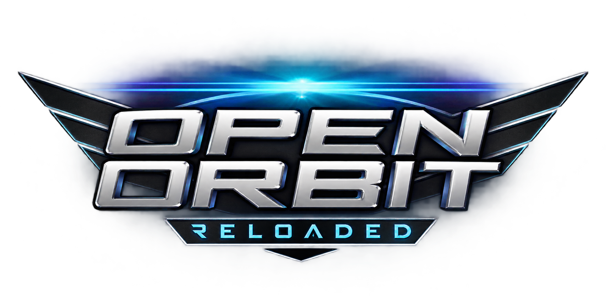
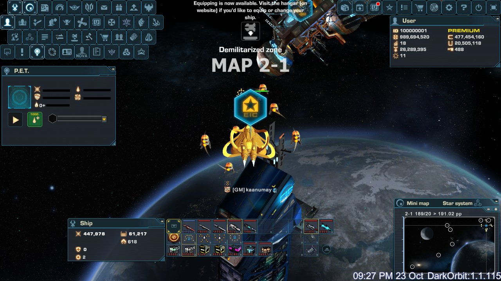
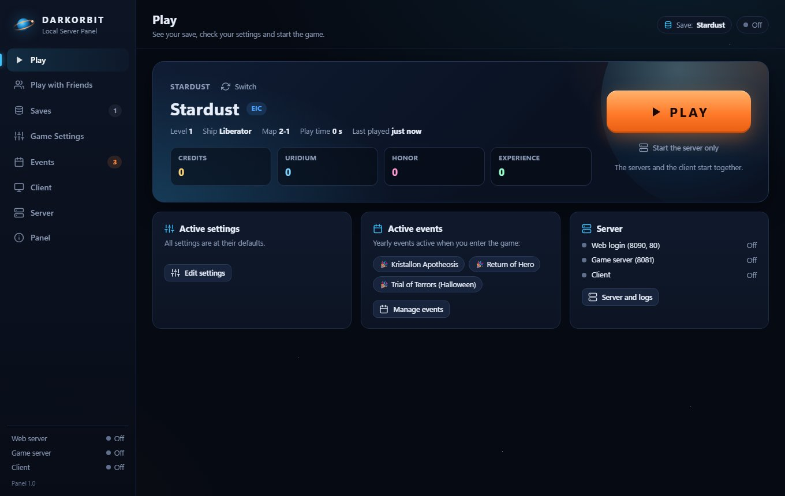
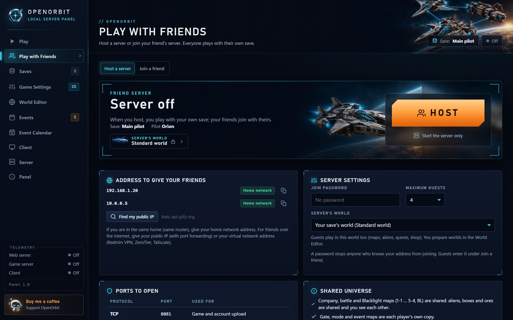
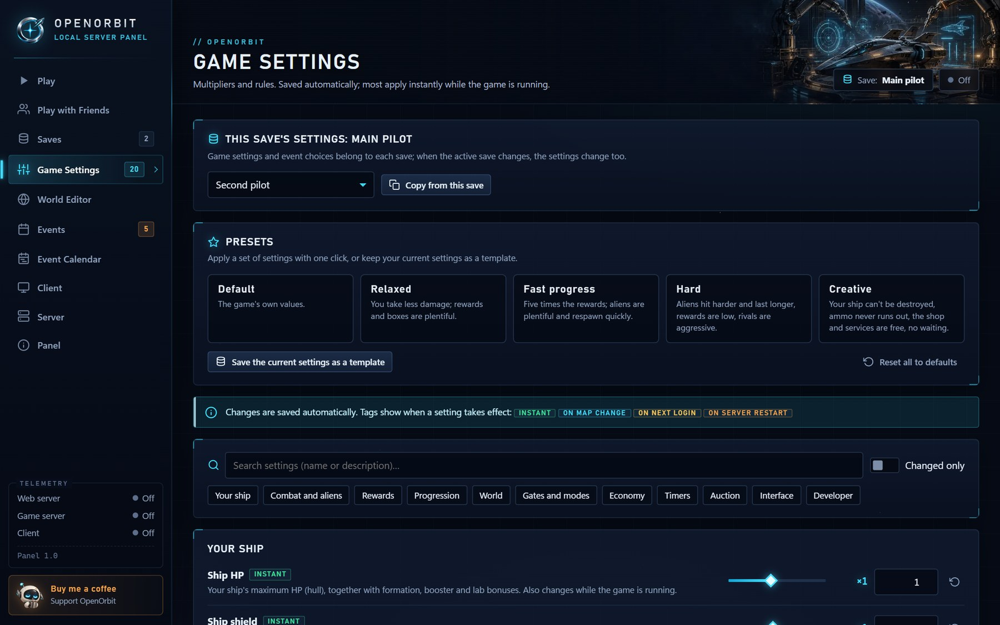
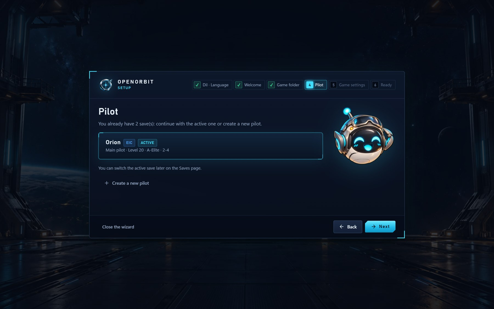

<h1 align="center"></h1>

**[English](#english)** · **[Türkçe](#türkçe)** · **[Discord](https://discord.gg/BUb9rNTKNt)**

[](https://discord.gg/BUb9rNTKNt)

A single-player, offline server for the original DarkOrbit Unity client, with a desktop management panel.
Orijinal DarkOrbit Unity istemcisi için tek oyunculu, çevrimdışı sunucu ve masaüstü yönetim paneli.



| Play · Oyna | Play with Friends · Arkadaşlarınla Oyna |
| --- | --- |
|  |  |
| **Game Settings · Oyun Ayarları** | **Setup wizard · Kurulum sihirbazı** |
|  |  |

---

## English

### What it is

OpenOrbit runs a local server on your computer and starts the **original DarkOrbit client** against it.
You play alone and offline: the client never connects to the official servers and its own files are never changed (on
Windows the panel adds BepInEx next to them for a few small [client fixes](#client-fixes-bepinex)). Internet is needed only
to download the game and BepInEx (once, if the panel does it for you), to check for updates and to fetch the game's
images from the official CDN the first time they are shown (without internet the game still runs, without those
images). A management panel starts the game and handles your saves, game settings and events.

### Features

- **Your own account:** the full account interface (windows, missions, Season Pass, Command Center) with progress that
  is saved locally.
- **Combat and the world:** aliens on every map, lasers, rockets, launchers, mines, ship abilities, bonus and cargo boxes,
  mining and refining, portals and death screens.
- **Equipment:** shop, hangar, ships and designs, drones and formations, P.E.T., boosters. Items that are sold for real
  money on the official servers can be bought with uridium.
- **Galaxy Gates and modes:** Galaxy Gates (Kronos included), event gates, Voyagers' Ascent, Trinity Trials, Astral
  Ascension, Deep Space Echoes, Eternal Black Light and more.
- **Systems:** Assembly, Dispatch, Skylab, Uridium Bank, Synthesis, N.O.V.A., Armory, Quantum Fluid Core, particle
  cannons, Singularity Drive, Omega AutoTactic, pilot skills, achievements and titles, ranks, daily login, Battle Pass.
- **Events:** yearly and weekly events follow the real calendar; you can switch each one on or off in the panel.
- **Social, single-player:** chat, mail, clans and the auction (with optional virtual rivals). Bot players are planned.

### The management panel

- **First-run setup wizard:** language (English or Turkish), game folder (downloaded for you if it isn't on your
  computer), your first pilot and game settings.
- **Play:** your active save, the PLAY button, launch steps, warnings and live status while you play.
- **Play with Friends:** host a server or join a friend's; everyone plays with their own save (see below).
- **Saves:** several save slots; create, rename, copy, export and import (.zip), edit (credits, uridium, give items,
  repair the ship …), and automatic or manual backups that you can restore.
- **Game Settings:** multipliers and rules (damage, rewards, drop chances, alien and box counts, prices, cooldowns …),
  presets such as Relaxed, Fast progress and Hard, and your own templates. Most settings apply while you play. Many of them
  can be fine-tuned per source, e.g. uridium from aliens, boxes, quests, gates and modes, or shop prices in credits and uridium.
- **Events:** each event by calendar, or on / off by hand.
- **Client:** game folder, game download, version check, window mode, resolution and display.
- **Server:** processes, ports, behavior and live logs.
- **Panel:** language, setup wizard, updates, desktop shortcut, folders and a button to join the Discord server.

### Playing with friends

- **Host:** on the Play with Friends page, HOST starts the server for everyone and opens the game with your own save.
  You can set a join password and the maximum number of guests. The page shows the addresses to give your friends and
  lists connected guests (you can remove one).
- **Ports:** TCP 8081 (game and account upload) and TCP 7771 (chat). No UDP port is needed; the web login (80, 8090)
  stays on your computer. Allow Python through Windows Firewall when it asks. On the same home network nothing else is
  needed; over the internet forward those two ports on your router, or use a virtual network (Radmin VPN, ZeroTier,
  Tailscale) if your provider uses CGNAT.
- **Join:** enter your friend's address (and password), pick a save and press JOIN. Your save is backed up, uploaded to
  your friend's server and the game opens. While you play, your progress is written back to your own save every few
  seconds; when you leave or close the game, its final state is saved on your computer.
- **Your save stays yours:** the host keeps guests' saves in memory only; they never appear on the host's Saves page.
- **What is shared:** company, battle and Blacklight maps (1-1 … 5-4, BL): aliens, boxes and ores, and you see each
  other. Chat is shared. Gates, modes and event maps are each player's own copy; mail, clans and the auction stay
  personal. The host's game settings apply to everyone. There is no PvP.
- Both sides need the same panel and game version.

### Requirements

- Windows 10 or 11. Linux and macOS work too: the game opens with Proton or Wine (see [Linux and macOS](#linux-and-macos)).
- [Python](https://www.python.org/downloads/windows/) 3.10 or newer. Nothing else is needed to play.
- The **original DarkOrbit Unity client**, version **1.1.115** (not included). If the panel doesn't find it on your
  computer, the setup wizard downloads it from the game's official download server and installs it into the project
  folder: about 3.5 GB to download and 4.4 GB of free disk space. A stopped download resumes where it left off. If you
  install it yourself, the folder must contain `DarkOrbit.exe` and `DarkOrbit_Data`.
- Microsoft Edge or Google Chrome for the panel window (otherwise your default browser opens it).
- Optional: `pip install capstone`, only if you want to adapt the server to a newer client version (Client page).

### Quick start

1. Download this repository (Code > Download ZIP) and extract it, or clone it.
2. Double-click **`OpenOrbit Panel.pyw`**. The panel opens in its own window; no console window appears.
3. Follow the setup wizard: choose a language, pick the DarkOrbit game folder (it is found automatically in the usual
   places; if the game isn't on your computer, the wizard downloads it), create your first pilot and choose a preset.
4. Press **PLAY**. The servers start and the game opens. On the client's login screen press START.

You can run the wizard again at any time from the **Panel** page, where you can also switch the language and put a
desktop shortcut on your desktop.

### Client fixes (BepInEx)

On Windows the panel installs [BepInEx](https://github.com/BepInEx/BepInEx) 6 into the game folder (about 32 MB, in the
setup wizard's game folder step or on the first PLAY; the **Client** page shows its state) and loads a small OpenOrbit
plugin with it that fixes a few bugs of the client itself: the auction countdown after a period ends, the "Your Rank" line
of the rank window and the total box of free shop items. The client's own files are not changed; BepInEx's files are added
next to them (`winhttp.dll`, `doorstop_config.ini`, `BepInEx/`, `dotnet/`). BepInEx is active only when the panel starts
the game: started any other way, the client runs unchanged. The first start after installing takes about half a minute
longer while BepInEx prepares. If BepInEx can't be installed, the game opens without the fixes. The plugin's source is
`server/panel/eklenti/Yamalar.cs`.

### Linux and macOS

The panel and the servers are plain Python; the game client is a 32-bit Windows program, so the panel opens it with
**Proton** or **Wine**. On the **Client** page (Wine / Proton card) you can pick one, give its path or your own command.

**macOS** (macOS 14 Sonoma or newer): there is nothing to install by hand besides Python. *Automatic* uses the panel's own
Wine: an open-source Wine build with [DXMT](https://github.com/3Shain/dxmt), which translates the game's Direct3D 11 to Metal
(plain Wine can't draw the game on macOS). The panel downloads it (about 500 MB, into `server/save/wine_motoru/`) along with
the game in the setup wizard, or on the first PLAY. On Apple Silicon, Wine needs Rosetta 2: if it is missing, the panel shows
an *Install Rosetta* button that asks for your administrator password once. The web login's ports need no setup on macOS.

1. Install Python 3.10 or newer from [python.org](https://www.python.org/downloads/macos/) and, for the panel window, Chrome,
   Edge, Chromium or Brave (otherwise your default browser opens it).
2. Start the panel in the project folder with `python3 "OpenOrbit Panel.pyw"`. *Create shortcut* on the **Panel** page puts
   `OpenOrbit.app` on your desktop; from then on, double-click that.

**Linux:** *Automatic* uses Steam's Proton (through
[umu-launcher](https://github.com/Open-Wine-Components/umu-launcher) if it is installed), otherwise Wine.

1. Install Python 3.10 or newer (Debian/Ubuntu: also `python3-tk` for the file dialogs) and, for the panel window,
   Chrome, Chromium, Edge or Brave (otherwise your default browser opens it).
2. Install a Proton version in Steam (Library > Tools, e.g. Proton Experimental or GE-Proton), or Wine
   (`sudo apt install wine`; Debian and Ubuntu also need `wine32:i386`).
3. Once: the client expects its web login on port 80, which Linux opens only to root. Run this in a terminal (it stays
   set; it lets programs open ports from 80 up without root). The panel warns you until it's done.
   ```bash
   echo net.ipv4.ip_unprivileged_port_start=80 | sudo tee /etc/sysctl.d/90-openorbit.conf && sudo sysctl --system
   ```
4. Start the panel in the project folder with `python3 "OpenOrbit Panel.pyw"`. *Create shortcut* on the **Panel** page
   puts OpenOrbit on your desktop and in the app menu.

The game runs in its own prefix (`server/save/proton` or `server/save/wine`), which is set up the first time the game
opens (about half a minute). Wine's output goes to `server/logs/wine.log`. For Play with Friends, allow incoming connections
for Python when macOS asks; on Linux, if a firewall such as ufw is on, allow TCP 8081 and 7771. The
[client fixes](#client-fixes-bepinex) (BepInEx) are applied only on Windows, not under Wine or Proton. Linux and macOS
support is new: please report problems on Discord.

### Updates

The panel checks this repository for a newer version shortly after it starts and then every six hours. By default it
installs the update by itself once the game and the servers are closed, then restarts; the open panel window reloads.
On the **Panel** page you can choose *Only notify* or turn it off, and check by hand.

- **Downloaded as a ZIP** (no Git needed): the new version's archive (about 2 MB) is downloaded, changed files are
  replaced and files that were removed from the project are taken out. Their old versions are kept in
  `server/save/guncelleme/` (last two updates).
- **Cloned with Git:** the panel fast-forwards with `git`. If you changed tracked files or have commits of your own, it
  changes nothing and only tells you.
- Your saves, settings, logs, personal login templates, downloaded game images and the game client are never changed.
- **Coming from the old name (DarkOrbit Server Emulator):** versions from before 24 October 2026 can't update themselves
  any more (the panel says *The archive is not this project.*). Download the ZIP once more and copy its contents over your
  folder; your saves, settings and the game stay. Then open the panel with `OpenOrbit Panel.pyw`; the **Panel** page
  replaces the old desktop shortcut when you press *Create shortcut*.

### In-game tips

- Choose the game's own language on the client's login screen (the selector at the top, before START).
- 2D or 3D: Settings > Display > Choose 2D version, Save, OK; the game opens in that mode next time you enter.
- Missions are taken at Mission Control in the stations. Quit with the in-game logout button: it saves cleanly.
- Game Settings > Developer > GM console turns on the game's hidden admin window (Ctrl, then Shift, then Z in the game):
  teleport, spawn aliens and boxes, give items, finish missions, reset cooldowns.

### Where your data is

| Path | Contents |
| --- | --- |
| `server/save/kayitlar/<save>/` | A save slot: `profil.json` and its backups (`yedek/`) |
| `server/save/ayarlar.json` | Game settings and event choices |
| `server/save/panel.json` | Panel settings (language, game folder, display, backups) |
| `server/logs/` | Server, client and panel logs |
| `DarkOrbit_Version1.1.115/` | The game client, if the panel downloaded it (`istemci_indiriliyor/` while downloading) |
| `server/save/guncelleme/` | Old versions of the files that updates replaced (last two updates) |
| `server/cdn/do_img/` | Game images downloaded from the official CDN (news, event and window artwork) |
| `server/save/proton/`, `server/save/wine/` | Linux and macOS: the game's Proton data or Wine prefix |
| `server/save/wine_motoru/` | macOS: the Wine and DXMT the panel installed |

All of these are created on first run and stay on your computer.

### Good to know

- Don't run `DarkorbitLauncher.exe` from the client folder: it may update the client from the official servers and break
  compatibility. Start the game from the panel.
- The server is written for client version 1.1.115. For another version the panel warns you and can adapt the protocol
  from the new client's code (Client page; needs `capstone`).
- Bot players are not in yet: missions that need other players don't progress.

### Community

Join the [Discord server](https://discord.gg/BUb9rNTKNt) for announcements, help, bug reports and suggestions. It has
Turkish and English channels, and channels for screenshots and finding people to play with. You can also join from the
panel's **Panel** page.

### Legal

This is a fan project for personal, offline use. It is not affiliated with or endorsed by Bigpoint GmbH. DarkOrbit, the
client, graphics, sounds and texts belong to Bigpoint GmbH; part of the game data is compiled from darkorbitwiki.com.
Don't use it to connect to or harm the official servers.

The repository contains neither the game client nor the game's images: you download the client from Bigpoint's official
download server (or the panel does it for you), and the server fetches each image from the official CDN the first time
the game shows it and keeps it on your computer. The software is provided as is, without any warranty.

The project's own code is released under the [MIT License](LICENSE). It doesn't cover Bigpoint's client, graphics,
sounds, texts or game data.

---

## Türkçe

### Nedir

OpenOrbit bilgisayarında yerel bir sunucu çalıştırır ve **orijinal DarkOrbit istemcisini** ona bağlar.
Tek başına ve çevrimdışı oynarsın: istemci resmî sunuculara bağlanmaz, kendi dosyaları değiştirilmez (Windows'ta panel
birkaç küçük istemci düzeltmesi için yanlarına BepInEx ekler; aşağıda *İstemci düzeltmeleri*). İnternet yalnız oyunu ve
BepInEx'i indirmek (panel senin için indirirse, bir kez), güncellemeleri denetlemek ve oyunun görsellerini ilk
gösterildiklerinde resmî CDN'den almak için gerekir (internet yoksa oyun yine çalışır, o görseller olmadan). Bir yönetim
paneli oyunu başlatır; kayıtlarını, oyun ayarlarını ve etkinlikleri yönetir.

### Özellikler

- **Kendi hesabın:** hesabın tam arayüzü (pencereler, görevler, Season Pass, Command Center); ilerleme yerelde saklanır.
- **Savaş ve dünya:** her haritada uzaylılar, lazer, roket, fırlatıcı, mayın, gemi yetenekleri, bonus ve kargo kutuları,
  maden ve rafine, portallar, ölüm ekranı.
- **Donanım:** mağaza, hangar, gemiler ve tasarımlar, dronlar ve formasyonlar, P.E.T., boosterlar. Resmî sunucularda
  gerçek parayla satılan eşyalar uridyumla alınır.
- **Galaksi Kapıları ve modlar:** Galaksi Kapıları (Kronos dahil), etkinlik kapıları, Voyagers' Ascent, Trinity Trials,
  Astral Ascension, Deep Space Echoes, Eternal Black Light ve dahası.
- **Sistemler:** Assembly, Dispatch, Skylab, Uridium Bank, Synthesis, N.O.V.A., Armory, Quantum Fluid Core, parçacık
  topları, Singularity Drive, Omega AutoTactic, pilot yetenekleri, başarımlar ve unvanlar, rütbe, günlük giriş, Battle Pass.
- **Etkinlikler:** yıllık ve haftalık etkinlikler gerçek takvime göre açılır; her birini panelden açıp kapatabilirsin.
- **Sosyal, tek oyunculu:** sohbet, posta, klan ve müzayede (isteğe bağlı sanal rakiplerle). Bot oyuncular planlanıyor.

### Yönetim paneli

- **İlk açılışta kurulum sihirbazı:** dil (Türkçe ya da İngilizce), oyun klasörü (bilgisayarında yoksa indirilir), ilk
  pilotun ve oyun ayarları.
- **Oyna:** etkin kaydın, OYNA düğmesi, başlatma adımları, uyarılar ve oynarken canlı durum.
- **Arkadaşlarınla Oyna:** sunucu kur ya da arkadaşının sunucusuna katıl; herkes kendi kaydıyla oynar (aşağıda).
- **Kayıtlar:** birden çok kayıt yuvası; oluştur, yeniden adlandır, kopyala, dışa ve içe aktar (.zip), düzenle (kredi,
  uridyum, eşya ver, gemiyi onar …), otomatik ya da elle yedekler ve geri yükleme.
- **Oyun Ayarları:** çarpanlar ve kurallar (hasar, ödüller, düşme şansı, uzaylı ve kutu sayısı, fiyatlar, beklemeler …),
  Rahat, Hızlı ilerleme, Zorlu gibi hazır ayarlar ve kendi şablonların. Çoğu ayar oynarken uygulanır. Birçoğu kaynağa göre
  ayrıntılı ayarlanır: ör. uzaylılardan, kutulardan, görevlerden, kapılardan ve modlardan gelen uridyum, kredi ve uridyumla
  satılanların mağaza fiyatı.
- **Etkinlikler:** her etkinlik takvime göre ya da elle açık / kapalı.
- **İstemci:** oyun klasörü, oyunu indirme, sürüm denetimi, pencere kipi, çözünürlük ve ekran.
- **Sunucu:** süreçler, portlar, davranış ve canlı günlükler.
- **Panel:** dil, kurulum sihirbazı, güncellemeler, masaüstü kısayolu, klasörler ve Discord sunucusuna katılma düğmesi.

### Arkadaşlarınla oynamak

- **Host:** Arkadaşlarınla Oyna sayfasında SUNUCU KUR herkes için sunucuyu başlatır ve oyunu kendi kaydınla açar. Katılma
  şifresi ve en çok misafir sayısı seçilebilir. Sayfa arkadaşlarına vereceğin adresleri gösterir ve bağlı misafirleri
  listeler (birini çıkarabilirsin).
- **Portlar:** TCP 8081 (oyun ve hesap gönderimi) ve TCP 7771 (sohbet). UDP portu gerekmez; web girişi (80, 8090) senin
  bilgisayarında kalır. Windows Güvenlik Duvarı sorunca Python'a izin ver. Aynı ev ağında başka bir şey gerekmez;
  internet üzerinden modeminde bu iki portu yönlendir, sağlayıcın CGNAT kullanıyorsa sanal ağ kur (Radmin VPN, ZeroTier,
  Tailscale).
- **Join:** arkadaşının adresini (ve şifreyi) yaz, kaydını seç ve KATIL'a bas. Kaydın yedeklenir, arkadaşının sunucusuna
  gönderilir ve oyun açılır. Oynarken ilerlemen birkaç saniyede bir kendi kaydına yazılır; ayrılınca ya da oyunu
  kapatınca son hâli bilgisayarına kaydedilir.
- **Kaydın senin:** sunucu misafirlerin kaydını yalnız bellekte tutar; sunucunun Kayıtlar sayfasında görünmez.
- **Ortak olanlar:** firma, savaş ve Blacklight haritaları (1-1 … 5-4, BL): uzaylılar, kutular ve cevherler, birbirinizi
  görürsünüz. Sohbet ortak. Kapı, mod ve etkinlik haritaları herkesin kendi kopyası; posta, klan ve müzayede kişisel.
  Sunucunun oyun ayarları herkese uygulanır (GM konsolu yalnız sunucuyu kuranda). PvP yok.
- İki tarafta da panel ve oyun sürümü aynı olmalı.

### Gereksinimler

- Windows 10 ya da 11. Linux ve macOS'ta da çalışır: oyun Proton ya da Wine ile açılır ([Linux ve macOS](#linux-ve-macos)).
- [Python](https://www.python.org/downloads/windows/) 3.10 ya da daha yenisi. Oynamak için başka bir şey gerekmez.
- **Orijinal DarkOrbit Unity istemcisi**, sürüm **1.1.115** (depoda yok). Panel onu bilgisayarında bulamazsa kurulum
  sihirbazı oyunun resmî indirme sunucusundan indirip proje klasörüne kurar: yaklaşık 3,5 GB indirme ve 4,4 GB boş disk
  alanı. Durdurulan indirme kaldığı yerden sürer. Kendin kurarsan klasörde `DarkOrbit.exe` ve `DarkOrbit_Data` olmalı.
- Panel penceresi için Microsoft Edge ya da Google Chrome (yoksa varsayılan tarayıcın açar).
- İsteğe bağlı: `pip install capstone`; yalnız sunucuyu daha yeni bir istemci sürümüne uyarlamak istersen (İstemci sayfası).

### Hızlı başlangıç

1. Bu depoyu indir (Code > Download ZIP) ve aç ya da klonla.
2. **`OpenOrbit Panel.pyw`** dosyasına çift tıkla. Panel kendi penceresinde açılır; konsol penceresi çıkmaz.
3. Kurulum sihirbazını izle: dili seç, DarkOrbit oyun klasörünü seç (bilinen yerlerde kendiliğinden bulunur; oyun
   bilgisayarında yoksa sihirbaz indirir), ilk pilotunu oluştur ve bir hazır ayar seç.
4. **OYNA**'ya bas. Sunucular başlar, oyun açılır. İstemcinin giriş ekranında START'a bas.

Sihirbazı istediğin zaman **Panel** sayfasından yeniden açabilirsin; dili değiştirmek ve masaüstüne kısayol koymak da
orada.

### İstemci düzeltmeleri (BepInEx)

Windows'ta panel oyun klasörüne [BepInEx](https://github.com/BepInEx/BepInEx) 6'yı kurar (yaklaşık 32 MB; sihirbazın oyun
klasörü adımında ya da ilk OYNA'da, durumu **İstemci** sayfasında) ve onunla istemcinin kendi birkaç hatasını düzelten küçük
bir OpenOrbit eklentisi yükler: dönem bitince müzayede sayacı, rütbe penceresindeki "Your Rank" satırı ve bedava mağaza
ürünlerinin toplam kutusu. İstemcinin kendi dosyaları değişmez; BepInEx'in dosyaları yanlarına eklenir (`winhttp.dll`,
`doorstop_config.ini`, `BepInEx/`, `dotnet/`). BepInEx yalnız oyunu panel açınca etkindir: başka yoldan açılan istemci
olduğu gibi çalışır. Kurulumdan sonraki ilk açılış, BepInEx hazırlandığı için yarım dakika kadar uzun sürer. BepInEx
kurulamazsa oyun düzeltmeler olmadan açılır. Eklentinin kaynağı `server/panel/eklenti/Yamalar.cs`.

### Linux ve macOS

Panel ve sunucular düz Python; oyun istemcisi 32 bitlik bir Windows programı, bu yüzden panel onu **Proton** ya da **Wine** ile
açar. **İstemci** sayfasındaki Wine / Proton kartından birini seçebilir, yolunu ya da kendi komutunu yazabilirsin.

**macOS** (macOS 14 Sonoma ya da daha yenisi): Python dışında elle bir şey kurmazsın. *Otomatik* panelin kendi Wine'ını kullanır:
açık kaynak bir Wine derlemesi ve oyunun Direct3D 11'ini Metal'e çeviren [DXMT](https://github.com/3Shain/dxmt) (düz Wine oyunu
macOS'ta çizemez). Panel onu kurulum sihirbazında oyunla birlikte ya da ilk OYNA'da indirir (yaklaşık 500 MB,
`server/save/wine_motoru/`'na). Apple Silicon'da Wine Rosetta 2 ister: yoksa panel *Rosetta'yı kur* düğmesini gösterir, yönetici
şifreni bir kez sorar. Web girişinin portları için macOS'ta bir şey gerekmez.

1. [python.org](https://www.python.org/downloads/macos/)'dan Python 3.10 ya da daha yenisini ve panel penceresi için Chrome, Edge,
   Chromium ya da Brave'i kur (yoksa varsayılan tarayıcın açar).
2. Paneli proje klasöründe `python3 "OpenOrbit Panel.pyw"` ile aç. **Panel** sayfasındaki *Kısayol oluştur* masaüstüne
   `OpenOrbit.app` koyar; sonra ona çift tıkla.

**Linux:** *Otomatik* Steam'in Proton'unu kullanır ([umu-launcher](https://github.com/Open-Wine-Components/umu-launcher)
kuruluysa onunla), yoksa Wine'ı.

1. Python 3.10 ya da daha yenisini (Debian/Ubuntu'da dosya pencereleri için `python3-tk` de) ve panel penceresi için Chrome,
   Chromium, Edge ya da Brave'i kur (yoksa varsayılan tarayıcın açar).
2. Steam'de bir Proton sürümü kur (Kütüphane > Araçlar, ör. Proton Experimental ya da GE-Proton) ya da Wine kur
   (`sudo apt install wine`; Debian ve Ubuntu'da `wine32:i386` de gerekir).
3. Bir kez: istemci web girişini 80 portunda bekliyor, Linux bu portu yalnız root'a açıyor. Terminalde şunu çalıştır (kalıcıdır;
   programların root olmadan 80 ve üstü portları açmasına izin verir). Yapılana dek panel uyarır.
   ```bash
   echo net.ipv4.ip_unprivileged_port_start=80 | sudo tee /etc/sysctl.d/90-openorbit.conf && sudo sysctl --system
   ```
4. Paneli proje klasöründe `python3 "OpenOrbit Panel.pyw"` ile aç. **Panel** sayfasındaki *Kısayol oluştur* OpenOrbit'i
   masaüstüne ve uygulama menüsüne koyar.

Oyun kendi önekinde çalışır (`server/save/proton` ya da `server/save/wine`); önek oyun ilk açıldığında kurulur (yarım dakika
kadar). Wine'ın çıktısı `server/logs/wine.log`'a yazılır. Arkadaşlarınla Oyna için macOS sorarsa Python'a gelen bağlantı izni ver;
Linux'ta ufw gibi bir güvenlik duvarı açıksa TCP 8081 ve 7771'e izin ver. İstemci düzeltmeleri (BepInEx) yalnız Windows'ta
uygulanır, Wine ve Proton'da uygulanmaz. Linux ve macOS desteği yeni: sorunları Discord'da bildir.

### Güncellemeler

Panel açıldıktan kısa süre sonra ve sonra altı saatte bir bu depoda yeni sürüm olup olmadığına bakar. Varsayılan olarak
oyun ve sunucular kapanınca güncellemeyi kendisi kurar ve yeniden başlar; açık panel penceresi kendini yeniler. **Panel**
sayfasından *Yalnız haber ver*'i seçebilir, kapatabilir ve elle denetleyebilirsin.

- **ZIP olarak indirdiysen** (Git gerekmez): yeni sürümün arşivi (yaklaşık 2 MB) indirilir, değişen dosyalar yenilenir,
  projeden kaldırılan dosyalar çıkarılır. Eski hâlleri `server/save/guncelleme/`'de saklanır (son iki güncelleme).
- **Git ile klonladıysan:** panel `git` ile ileri sarar. İzlenen dosyaları değiştirdiysen ya da kendi commit'lerin varsa hiçbir
  şeye dokunmaz, yalnız haber verir.
- Kayıtların, ayarların, günlüklerin, kişisel giriş şablonların, inen oyun görselleri ve oyun istemcisi hiç değişmez.
- **Eski addan (DarkOrbit Server Emulator) geliyorsan:** 24 Ekim 2026'dan önceki sürümler artık kendiliğinden
  güncellenemez (panel *Arşiv bu projenin değil.* der). ZIP'i bir kez daha indirip içindekileri klasörünün üstüne kopyala;
  kayıtların, ayarların ve oyun yerinde kalır. Sonra paneli `OpenOrbit Panel.pyw` ile aç; **Panel** sayfasında
  *Kısayol oluştur*'a basınca eski masaüstü kısayolu yenisiyle değişir.

### Oyun içi ipuçları

- Oyunun kendi dilini istemcinin giriş ekranında seç (START'tan önce üstteki seçici).
- 2D ya da 3D: Ayarlar > Display > Choose 2D version, Save, OK; oyuna yeniden girince o kipte açılır.
- Görevler istasyonlardaki Mission Control'den alınır. Oyundan çıkış düğmesiyle çık: kayıt sorunsuz kapanır.
- Oyun Ayarları > Geliştirici > GM konsolu oyunun gizli yönetici penceresini açar (oyunda Ctrl, ardından Shift, ardından Z):
  ışınlanma, uzaylı ve kutu doğurma, eşya verme, görevleri bitirme, beklemeleri sıfırlama.

### Verilerin nerede

| Yol | İçerik |
| --- | --- |
| `server/save/kayitlar/<kayıt>/` | Bir kayıt yuvası: `profil.json` ve yedekleri (`yedek/`) |
| `server/save/ayarlar.json` | Oyun ayarları ve etkinlik seçimleri |
| `server/save/panel.json` | Panel ayarları (dil, oyun klasörü, görüntü, yedekleme) |
| `server/logs/` | Sunucu, istemci ve panel günlükleri |
| `DarkOrbit_Version1.1.115/` | Oyun istemcisi, panel indirdiyse (inerken `istemci_indiriliyor/`) |
| `server/save/guncelleme/` | Güncellemelerin değiştirdiği dosyaların eski hâlleri (son iki güncelleme) |
| `server/cdn/do_img/` | Resmî CDN'den inen oyun görselleri (haber, etkinlik ve pencere görselleri) |
| `server/save/proton/`, `server/save/wine/` | Linux ve macOS: oyunun Proton verisi ya da Wine öneki |
| `server/save/wine_motoru/` | macOS: panelin kurduğu Wine ve DXMT |

Hepsi ilk açılışta oluşur ve bilgisayarında kalır.

### Bilmekte yarar var

- İstemci klasöründeki `DarkorbitLauncher.exe`'yi çalıştırma: istemciyi resmî sunuculardan güncelleyip uyumu bozabilir.
  Oyunu panelden başlat.
- Sunucu 1.1.115 istemcisi için yazıldı. Başka bir sürümde panel uyarır ve protokolü yeni istemcinin kodundan uyarlayabilir
  (İstemci sayfası; `capstone` gerekir).
- Bot oyuncular henüz yok: başka oyuncu gerektiren görevler ilerlemez.

### Topluluk

Duyurular, yardım, hata bildirimi ve öneriler için [Discord sunucusuna](https://discord.gg/BUb9rNTKNt) katıl. Türkçe ve
İngilizce kanalların yanında ekran görüntüleri ve birlikte oynayacak arkadaş bulmak için kanallar var. Panelin **Panel**
sayfasından da katılabilirsin.

### Yasal not

Kişisel, çevrimdışı kullanım için bir hayran projesidir; Bigpoint GmbH ile bağlantısı yoktur, onun onayını taşımaz.
DarkOrbit, istemci, grafikler, sesler ve metinler Bigpoint GmbH'ye aittir; oyun verilerinin bir kısmı darkorbitwiki.com'dan
derlenmiştir. Resmî sunuculara bağlanmak ya da onlara zarar vermek için kullanma.

Depoda ne oyun istemcisi ne de oyunun görselleri var: istemciyi Bigpoint'in resmî indirme sunucusundan sen indirirsin (ya
da panel senin için indirir); sunucu her görseli oyun onu ilk gösterdiğinde resmî CDN'den alır ve bilgisayarında saklar.
Yazılım olduğu gibi, hiçbir garanti olmadan sunulur.

Projenin kendi kodu [MIT Lisansı](LICENSE) ile yayımlanır. Bigpoint'in istemcisini, grafiklerini, seslerini, metinlerini
ve oyun verilerini kapsamaz.
